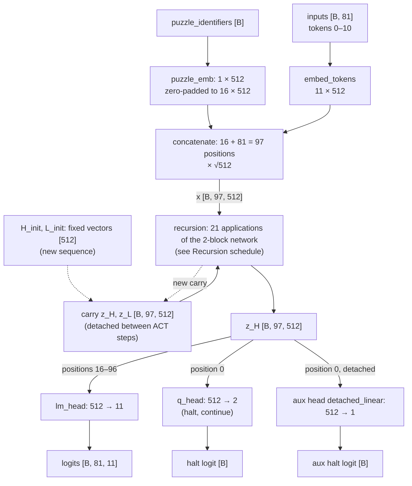
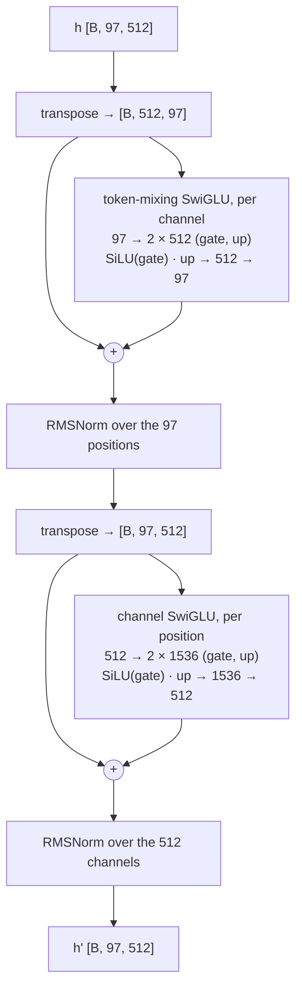
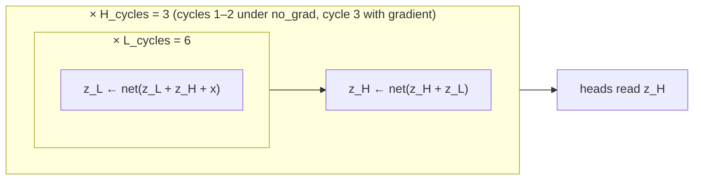

# TRM architecture (Sudoku-Extreme, MLP variant)

This document describes the network as this repository builds it for the Sudoku-Extreme
runs on the `aux-halt-heads` branch, e.g. `sudoku_aux_linear` and `sudoku_aux_linear_hms4`.
Everything below comes from the code:
[models/recursive_reasoning/trm.py](models/recursive_reasoning/trm.py) and
[models/layers.py](models/layers.py). Sizes come from the runs' `all_config.yaml`, and parameter
counts from an instantiated model.

The configuration differs from [config/arch/trm.yaml](config/arch/trm.yaml) through the
overrides in [slurm/train_sudoku.sbatch](slurm/train_sudoku.sbatch):

| Setting | Value | Meaning |
|---|---|---|
| `hidden_size` | 512 | width D of every position's state |
| `L_layers` | 2 | blocks in the network (`H_layers` is ignored) |
| `mlp_t` | True | token mixing with an MLP across positions instead of self-attention |
| `pos_encodings` | none | no positional encoding; the token-mixing MLP has per-position weights |
| `expansion` | 4 | MLP expansion factor (before the 2/3 SwiGLU correction and rounding) |
| `H_cycles`, `L_cycles` | 3, 6 | recursion schedule inside one ACT step |
| `halt_max_steps` | 16 (or 4) | ACT steps per sequence |
| `puzzle_emb_ndim`, `puzzle_emb_len` | 512, 16 | puzzle-embedding prefix |
| `forward_dtype` | bfloat16 | activations; halt logits in float32 |

Data: `seq_len` = 81 cells, `vocab_size` = 11 (0 = padding, unused for Sudoku; 1 = blank;
2–10 = digits 1–9), `num_puzzle_identifiers` = 1 (every Sudoku has the same identifier).

## Overview

There is a single 2-block network, called `L_level` in the code. It is applied
over and over to two states of the same shape, `[B, 97, 512]`:

- the **answer state** `z_H`, which the output heads read;
- the **latent state** `z_L`.

The 97 positions are 16 prefix positions followed by the 81 cells. One **ACT step** applies the
network 21 times. A sequence runs up to `halt_max_steps` ACT steps, and the two states are
carried from one step to the next.



## Input encoding

- **Token embedding** `embed_tokens`: an 11 × 512 table. It is initialized with a truncated
  normal of std 1/√512.
- **Puzzle embedding** `puzzle_emb`: one 512-dimensional vector per puzzle identifier, so a
  single vector for Sudoku.
  - It is zero-initialized and stored as a buffer.
  - It is trained by its own sign-SGD optimizer, not by AdamATan2.
  - It is zero-padded to 16 × 512 and placed in front of the 81 cells. Only prefix position 0
    receives it; positions 1–15 enter the input as zeros, and their state comes from the
    recursion alone.
- **Scaling.** The whole sequence is multiplied by √512 ≈ 22.6. With
  `pos_encodings=none` there is no positional term.

The result `x` (shape `[B, 97, 512]`) is computed once per ACT step. It is fed in again at
every latent update.

## The block

`L_level` stacks 2 identical blocks with separate weights, and the same 2 blocks serve both
updates. Each block uses post-norm residuals:

- RMS normalization has no learnable scale (ε = 1e-5).
- No linear layer has a bias.
- There is no dropout.



Two details matter here:

- **The first norm runs across positions.** It is applied before transposing back, so each
  channel is normalized across the 97 positions.
- **The token-mixing weights are tied to position.** The same weights apply to every channel,
  but each input and output weight belongs to one cell or prefix position. Without positional
  encoding, this is where the model's knowledge of the grid layout lives.

The SwiGLU inner width is `round(expansion · n · 2/3)` rounded up to a multiple of 256: 512
for n = 97 and 1536 for n = 512.

The default `trm.yaml` (`mlp_t=False`) uses self-attention in place of the token-mixing
SwiGLU: 8 heads of size 64, RoPE, non-causal, a 512 → 1536 QKV projection and a 512 → 512
output projection. Each block then has 3.41M parameters instead of 2.51M, and the network
6.83M in total.

## Recursion schedule

The block stack is the function `net(h, injection)`: it adds the injection to `h`, then
applies the 2 blocks. One ACT step:

```text
z_H, z_L = carry                        # H_init / L_init for a new sequence
repeat H_cycles = 3 times:              # the first 2 cycles without gradient
    repeat L_cycles = 6 times:
        z_L = net(z_L, z_H + x)         # latent update: sees answer and input
    z_H = net(z_H, z_L)                 # answer update: does not see x
carry = (z_H.detach(), z_L.detach())
```



**Per ACT step:**
- `net` runs 3 × (6 + 1) = 21 times, which is 42 block passes.
- Backpropagation goes through the last 7 applications only (14 block passes). Earlier
  cycles, and earlier ACT steps through the detached carry, get no gradient.
- Forward compute is about 25.6 GFLOP per sequence, matrix multiplications only: 0.61 GFLOP
  per block pass, 75% of it in the channel SwiGLU.

**Effective depth:** 672 block passes at 16 ACT steps, 168 at 4.

## Heads

| Head | Input | Map | Output |
|---|---|---|---|
| `lm_head` | `z_H` at the 81 cell positions | linear 512 → 11, no bias | per-cell logits; argmax = predicted digit |
| `q_head` | `z_H` at position 0 | linear 512 → 2, with bias | halt logit (used) and continue logit (unused with `no_ACT_continue=True`) |
| `detached_linear` (auxiliary) | detached `z_H` at position 0 | linear 512 → 1, with bias | halt logit of an observer that never halts anything |

`q_head` and the auxiliary head start at weight 0 and bias −5, i.e. "don't halt". The auxiliary
head sees detached state only, so it cannot send gradients into the network. Its creation
also doesn't change the random numbers of the rest of the model (see
[models/aux_halt_heads.py](models/aux_halt_heads.py)).

## Parameters

Counted from the instantiated `sudoku_aux_linear_hms4` model:

| Module | Shape | Parameters |
|---|---|---:|
| `embed_tokens` | 11 × 512 | 5,632 |
| `puzzle_emb` (buffer, sign-SGD) | 1 × 512 | 512 |
| per block: token-mixing SwiGLU | 97 → 1024, 512 → 97 | 148,992 |
| per block: channel SwiGLU | 512 → 3072, 1536 → 512 | 2,359,296 |
| **per block** | | **2,508,288** |
| `L_level` (2 blocks) | | 5,016,576 |
| `lm_head` | 11 × 512 | 5,632 |
| `q_head` | 2 × 512 + 2 | 1,026 |
| `detached_linear` aux head | 1 × 512 + 1 | 513 |
| **trainable parameters** (without `puzzle_emb`) | | **5,029,379** |

The network holds 99.7% of the parameters, and the channel SwiGLU alone 94%.

Buffers that aren't trained: `H_init` and `L_init` (512 each, truncated normal with std 1),
plus the per-batch copy of the puzzle embeddings.

## Halting (ACT) and training

The paper's pseudocode is in [assets/TRM_pseudocode.png](assets/TRM_pseudocode.png).

**Batch slots.** A training batch has 768 slots. Each training step runs one ACT step for every
slot. A slot whose sequence halted loads a new puzzle at the next step, and its state is reset
to `H_init` / `L_init`.

**When a sequence halts in training:**
- at `halt_max_steps`;
- or when the halt logit is above 0;
- except that with probability 0.1 (`halt_exploration_prob`), halting is blocked until a
  minimum step, drawn uniformly from 2 to `halt_max_steps`.

**In evaluation,** every puzzle runs the full step limit (`halt_max_steps`, or
`eval_halt_max_steps`). Halting with a head at a threshold is an evaluation option
(`eval_halt_enable`).

**Loss per step,** summed over the sequences of the batch and divided by the batch size:
- **Answer loss:** stablemax cross-entropy, averaged over the cells. Stablemax replaces exp
  with s(x) = x + 1 for x ≥ 0 and 1 / (1 − x) for x < 0.
- **Halt loss:** 0.5 × the binary cross-entropy of the halt logit, with target "every cell is
  correct".
- **Auxiliary heads:** 0.5 × the same binary cross-entropy for each head.

**Optimization:**
- Weights: AdamATan2 (lr 1e-4, weight decay 1.0, betas 0.9 / 0.95, 2,000 warm-up steps).
- Puzzle embedding: sign-SGD with the same lr and weight decay.
- An EMA of the weights (rate 0.999) is what evaluation and the checkpoints use.

**Optional on this branch:** a warm-up before the supervised window
(`halt_warmup_prob`; see [slurm/README.md](slurm/README.md), section 7). It changes training
only.
